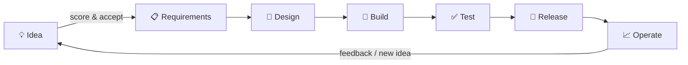
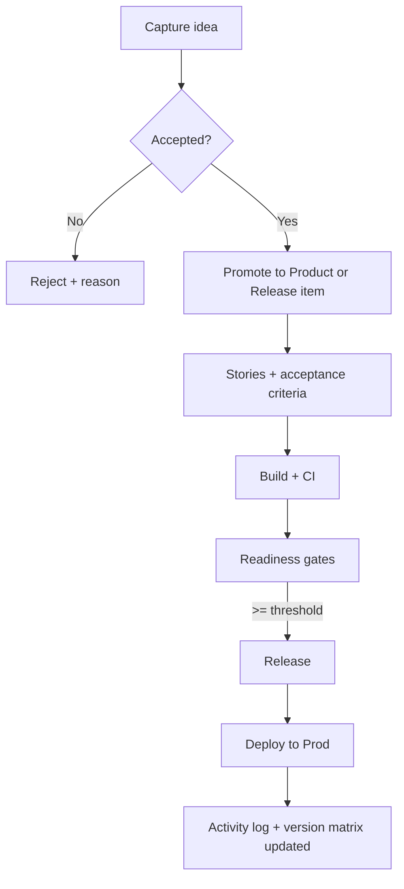
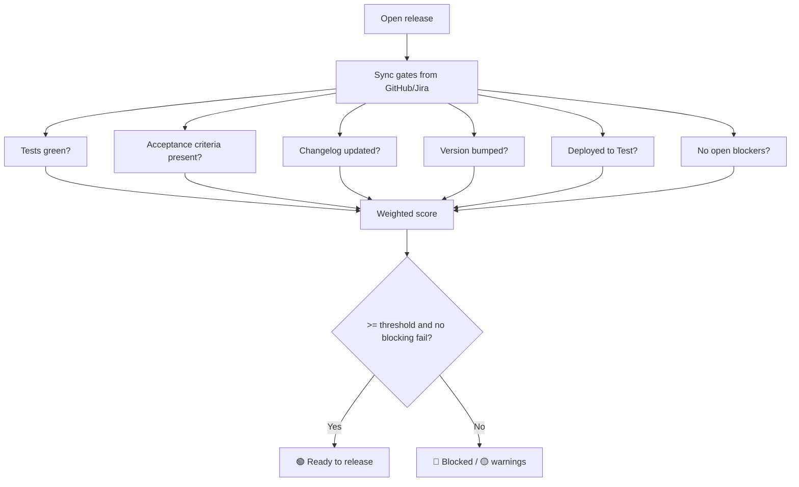
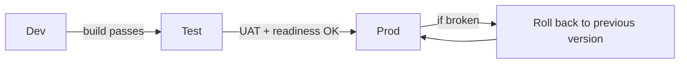
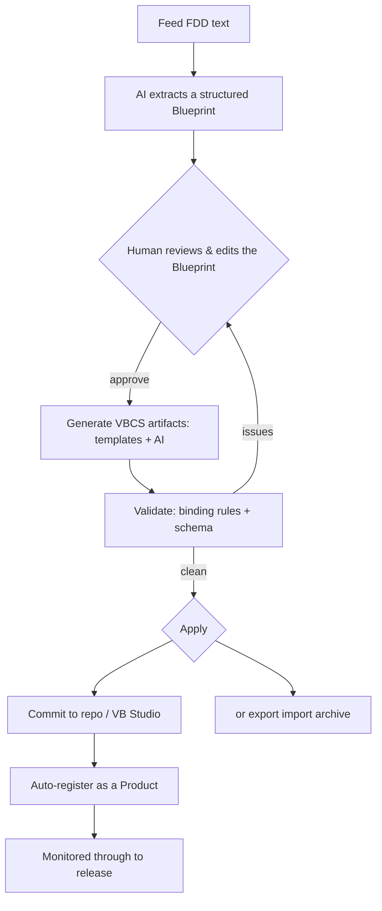

# Control Tower — Functional Design Document (FDD)

**How the product behaves: every feature, every screen, every rule.**
Companion to the RD (the *what/why*) and the TDD (the *technical how*). This is the *functional how*.

| | |
|---|---|
| **Product** | Control Tower — development‑lifecycle cockpit (VBCS) |
| **Document** | FDD v0.1 (draft for review) |
| **Reads with** | `control-tower-RD.md` (requirements), `control-tower-TDD.md` (technical design) |
| **Date** | 2026‑11‑07 |

> **Design principle 1 — "monitor everything."** Control Tower is the single source of truth for the *state* of every product you build. If a signal matters to shipping software — an idea, a story, a commit, a build, a test, a bug, a version, a deploy, an incident — it has a home here and a place it shows up on a screen (§2).
>
> **Design principle 2 — "build from the FDD."** Control Tower doesn't only watch products; it can *start* them. Feed it an FDD and its **AI interpreter** scaffolds the VBCS app — data model, pages, page features, flows, integrations — which is then monitored here through to release. One tool: idea → FDD → built → shipped → watched (module H / screen S16).

---

## 1. Scope & reading guide

- **§2** — the complete list of what the product monitors (the "everything").
- **§3** — the full feature catalog, grouped.
- **§4** — the screen inventory (every screen, numbered S1…S16).
- **§5** — per‑screen functional specs (layout, data, actions, rules, states).
- **§6** — status & lifecycle models (the state machines).
- **§7** — process flows (diagrams).
- **§8** — roles & permissions.
- **§9** — cross‑cutting functional rules (search, notifications, audit, errors).
- **§10** — sample acceptance criteria.

---

## 2. What Control Tower monitors (the full surface)

Grouped by lifecycle stage. Each row is a *signal* the app captures, stores, and surfaces somewhere.

| Stage | Signals monitored | Source |
|---|---|---|
| **Idea / Discovery** | ideas, value/effort scores, status, promotion to product/feature | manual |
| **Requirements** | epics, stories, acceptance‑criteria presence, scope changes | Jira |
| **Design** | design status, wireframe links, ADRs (decisions + consequences) | manual / repo |
| **Build — code** | repos, branches, commits, open PRs, review status, merge status | GitHub |
| **Build — CI** | build runs, pass/fail, duration, coverage % | GitHub Actions / VB Studio |
| **Test / Quality** | test results, open bugs by severity, quality gates, UAT sign‑off | Jira / CI |
| **Release** | releases, versions (per component + suite), release notes, train (26C…) | manual + GitHub tags |
| **Deploy** | environments (Dev/Test/Prod), deployed version per env, deploy history, health | VB Studio / manual |
| **Operate** | incidents, risks, post‑mortems, uptime/health, SLAs | manual / monitoring |
| **Cross‑cutting** | dependencies between products/components, ownership, security scans, **DORA metrics**, full **activity/audit log** | derived + scans |

**DORA metrics** (industry standard "are we a healthy team?" measures) are computed and trended per product: deployment frequency, lead time for change, change‑failure rate, mean‑time‑to‑restore. This is what makes it a true monitoring tool, not just a tracker.

---

## 3. Feature catalog

Grouped; each feature maps to screen(s) in §4 and requirements (FR‑n) in the RD.

**A. Portfolio & product**
- A1 Portfolio dashboard (all products, phase, readiness, risks) — S1
- A2 Product 360 (one product, everything) — S2
- A3 Product registration & settings — S14
- A4 Dependency map (what depends on what) — S12

**B. Discovery & planning**
- B1 Idea capture & scoring — S3
- B2 Idea → product/feature promotion — S3
- B3 Backlog / requirements view (stories, acceptance criteria) — S2/S3
- B4 Lifecycle board (portfolio Kanban by phase) — S4

**C. Build & quality (live)**
- C1 Git activity (branches, PRs, commits, review state) — S2
- C2 CI/build status (runs, pass/fail, coverage) — S2/S7
- C3 Bugs & quality gates — S7
- C4 ADRs (decision log) — S2

**D. Release & deploy**
- D1 Release register (all releases) — S5
- D2 Release detail (scope, notes, components) — S6
- D3 Release Readiness score + gates — S7
- D4 Version matrix (live vs latest) — S8
- D5 Release calendar on Oracle train — S9
- D6 Environments & deployment history — S2 (env panel) / S6

**E. Operate**
- E1 Risks & incidents register — S15
- E2 Post‑mortems — S15
- E3 Health/uptime per environment — S2

**F. Insight**
- F1 DORA & delivery metrics (trends) — S10
- F2 Activity / audit log — S11
- F3 Global search — global
- F4 Notifications / alerts — global

**G. Platform**
- G1 Integrations (GitHub, Jira, VB Studio, OIC) — S13
- G2 Admin: gate templates, lookups, sync settings — S14
- G3 AI assist (release notes, risk flags, status summaries) — embedded
- G4 Light/dark, responsive, self‑hosting (dogfood)

**H. Build — AI FDD Interpreter (Blueprint Studio)** *(flagship)*
- H1 Ingest an FDD (paste / upload) — S16
- H2 AI extraction → a structured **Blueprint** (entities, pages, flows, integrations, roles) — S16
- H3 Review & edit the Blueprint (the human checkpoint) — S16
- H4 Generate VBCS artifacts (Business Objects, pages, page features, flows, service connections, action chains) — S16
- H5 Validate generated pages against VBCS binding rules + schema — S16
- H6 Apply (commit to git / VB Studio) or export an import archive — S16
- H7 Auto‑register the generated app as a Product in the monitor (closes the loop) — S16 → S2

---

## 4. Screen inventory

| # | Screen | Primary job | Key feature(s) |
|---|--------|-------------|----------------|
| **S1** | Portfolio dashboard *(home)* | health of everything | A1 |
| **S2** | Product 360 | one product end‑to‑end | A2, B3, C1, C2, C4, D6, E3 |
| **S3** | Ideas & Backlog | capture/score/promote ideas | B1, B2 |
| **S3b** | Idea detail | one idea in depth | B1 |
| **S4** | Lifecycle board | portfolio by phase | B4 |
| **S5** | Releases | all releases register | D1 |
| **S6** | Release detail | one release | D2, D6 |
| **S7** | Release Readiness | go/no‑go score + gates | D3, C2, C3 |
| **S8** | Version matrix | what version is everything | D4 |
| **S9** | Calendar | releases on Oracle train | D5 |
| **S10** | Metrics (DORA) | delivery health trends | F1 |
| **S11** | Activity log | full audit trail | F2 |
| **S12** | Dependencies | product/component graph | A4 |
| **S13** | Integrations | connections & sync | G1 |
| **S14** | Admin | register products, gate templates, settings | A3, G2 |
| **S15** | Risks & Incidents | risk/incident register + post‑mortems | E1, E2 |
| **S16** | Blueprint Studio *(AI FDD Interpreter)* | turn an FDD into a scaffolded VBCS app | H1–H7 |
| **—** | Global: search, notifications, theme, profile | cross‑cutting | F3, F4, G4 |

*(S1–S9, S13, S14 are in the clickable prototype; S10–S12, S15, S16 are specced here for the full build.)*

---

## 5. Screen specifications

Each spec: **Purpose · Layout · Data shown · Actions · Business rules · States.**

### S1 — Portfolio dashboard *(home)*
- **Purpose:** one‑glance health of every product.
- **Layout:** KPI strip (4 tiles) → product card grid.
- **Data:** KPIs (total products, in build/test, releasing this quarter, open risks). Per card: name, tag, current phase chip, readiness ring + bar, next release, risk count.
- **Actions:** click card → S2; filter by phase/owner/readiness; sort; "+ New product" → S14.
- **Rules:** readiness ring colour = 🟢≥80 / 🟡60–79 / 🔴<60 / grey = n/a (pre‑build). KPI "releasing this quarter" counts releases whose train = current Oracle quarter.
- **States:** loading (skeleton cards) · loaded · empty ("Register your first product") · sync‑error banner (shows cached data + "stale" note).

### S2 — Product 360
- **Purpose:** everything about one product.
- **Layout:** header (name, tag, repo, quick actions) → phase stepper → two columns: **left** = Components table + Environments table + Git/CI panel; **right** = Readiness card + Current sprint + Links + Risks.
- **Data:** phase stepper (Idea→…→Release, current highlighted); components (name, type, latest version, prod version); environments (name, deployed version, when, health); git/CI (open PRs, last build status, coverage); current sprint (from Jira); open risks; links (repo, Jira, VB Studio, docs).
- **Actions:** Open repo ↗ · New release (→ S6 create) · open component/env/risk detail · advance phase.
- **Rules:** "In production" version is the version on the Prod environment record. A component whose latest ≠ prod shows an "undeployed changes" marker. Phase can only advance one step at a time (with confirm) unless Admin override.
- **States:** full · pre‑build (no components/envs → friendly placeholders) · partial sync.

### S3 — Ideas & Backlog
- **Purpose:** where products/features begin.
- **Layout:** toolbar ("+ New idea", filter by status) → table.
- **Data:** idea title, value, effort, score, status.
- **Actions:** new idea (inline/dialog) · open S3b · promote (→ creates Product or Release item) · change status.
- **Rules:** score = configurable formula (default value×effort weighting / RICE). Only **Accepted** ideas can be promoted. Promotion records a link from Idea → created entity (traceability).
- **States:** New · Evaluating · Accepted · Rejected · Promoted.

### S3b — Idea detail
- **Purpose:** one idea in depth.
- **Data:** problem, proposed value, effort, score breakdown, notes, status history.
- **Actions:** edit · score · promote · reject (with reason).

### S4 — Lifecycle board
- **Purpose:** the whole portfolio as a Kanban by phase.
- **Layout:** 6 columns = phases; cards = products (or releases, toggle).
- **Data:** per card: name, next release, readiness dot.
- **Actions:** drag card to next phase (updates product.phase, logged to activity) · click → S2.
- **Rules:** backward moves require confirm + reason; every move writes an activity entry.

### S5 — Releases
- **Purpose:** register of all releases across products.
- **Layout:** toolbar ("+ New release", filter by state/train/product) → table.
- **Data:** product, version, target date, train, state, readiness %.
- **Actions:** new release (→ S6) · open S6 · filter/sort.
- **Rules:** version must be unique per product+component. State flows per §6.

### S6 — Release detail
- **Purpose:** one release, cut to shipped.
- **Layout:** header (product, version, train, state) → tabs: **Scope** (stories/commits included), **Components** (versions in this release), **Notes** (release notes), **Readiness** (link to S7), **Deploy** (which env has it, history).
- **Data:** linked stories (Jira), linked commits/PRs (GitHub), component versions, release notes, deploy records.
- **Actions:** edit scope · auto‑draft notes (AI) · bump versions · mark Released · record deploy.
- **Rules:** cannot mark **Released** unless readiness ≥ threshold (default 80%) OR Admin override with reason. Marking Released: sets live versions, writes activity, marks Jira fixVersion released (if connected), updates version matrix.
- **States:** per §6 release state machine.

### S7 — Release Readiness *(signature)*
- **Purpose:** automatic go/no‑go.
- **Layout:** header (release selector) → big readiness ring + summary → gate list.
- **Data:** readiness % (ring, coloured), summary sentence, per gate: name, status (pass/warn/fail), detail, source, auto/manual.
- **Actions:** re‑sync gates · tick a manual gate · mark released (if allowed) · open the failing item (deep link to Jira/GitHub).
- **Rules:** readiness % = weighted pass ratio (see TDD §6). A **fail** on a blocking gate caps readiness and blocks release. Warn does not block but is surfaced.
- **States:** 🟢 Ready · 🟡 Warnings · 🔴 Blocked · computing.

### S8 — Version matrix
- **Purpose:** "what version is everything, and what's live?"
- **Layout:** grid — products (rows) × component types (columns) → version cell.
- **Data:** per cell: latest version + a green ● with the prod version when different.
- **Actions:** click cell → component history; filter to "has undeployed changes".
- **Rules:** suite/marketing version column maps to its component versions.

### S9 — Calendar
- **Purpose:** releases on Oracle's quarterly train.
- **Layout:** horizontal quarters (26A…27A), current highlighted; release chips per quarter.
- **Data:** quarter, dates, pinned releases (state‑coloured).
- **Actions:** click release → S6; flag releases landing in an Oracle update window.
- **Rules:** a release in a quarter where Oracle updates your test pod shows a ⚠ "validate on test pod first".

### S10 — Metrics (DORA & delivery)
- **Purpose:** delivery health over time.
- **Layout:** product/time filter → metric cards with sparklines → trend charts.
- **Data:** deployment frequency, lead time for change, change‑failure rate, MTTR; plus velocity, cycle time, readiness trend, bug burn‑down.
- **Actions:** filter by product/period; drill into a metric.
- **Rules:** metrics computed from deploy records, releases, incidents, and Jira throughput (see TDD §6). Each number states its source + window (provenance).
- **States:** enough‑data · insufficient‑data ("need ≥ N deploys").

### S11 — Activity / audit log
- **Purpose:** a complete, immutable trail of everything that changed.
- **Layout:** filter (product, type, actor, date) → reverse‑chronological list.
- **Data:** timestamp, actor (user/system/integration), entity, action, before→after.
- **Actions:** filter/search; export.
- **Rules:** every write in the app and every sync‑applied change writes one entry; entries are append‑only.

### S12 — Dependencies
- **Purpose:** see what depends on what (products, shared components, integrations).
- **Layout:** graph/matrix view.
- **Data:** nodes = products/components/integrations; edges = "depends on / calls / shares".
- **Actions:** click node → S2; highlight impact ("if I change X, what breaks?").
- **Rules:** a release touching a depended‑on component flags dependents for re‑test.

### S13 — Integrations
- **Purpose:** manage live connections.
- **Layout:** card per integration (GitHub, Jira, VB Studio, OIC).
- **Data:** name, status dot, last sync, scope summary.
- **Actions:** connect/disconnect · "Sync now" · configure scope.
- **Rules:** tokens entered via the secure Service‑Connection flow (never shown, never in data). Status reflects last sync result.

### S14 — Admin
- **Purpose:** configure the tool.
- **Layout:** sections: **Register product**, **Gate template**, **Lookups** (phases, environments, trains), **Sync settings**.
- **Data:** product form; gate list + weights; lookup lists; sync cadence.
- **Actions:** register product · add/edit/weight gates · edit lookups · set sync mode.
- **Rules:** registering a product applies the current gate template to its future releases; changing weights affects future readiness calculations only (historical scores are snapshots).

### S15 — Risks & Incidents
- **Purpose:** track what's at risk and what broke.
- **Layout:** two tabs — **Risks** (open risks by severity) and **Incidents** (with post‑mortems).
- **Data:** title, product, severity, status, owner, description; incident adds timeline + post‑mortem (what/impact/cause/fix/prevention).
- **Actions:** raise risk/incident · update status · write post‑mortem · link to a release/commit.
- **Rules:** an open **high/critical** risk shows on S1 KPIs and the product card; a critical incident feeds MTTR on S10.

### S16 — Blueprint Studio *(AI FDD Interpreter)* — flagship
- **Purpose:** feed an FDD; the app understands it and scaffolds the VBCS components — data model, pages, page features, flows, integrations.
- **Layout:** a 5‑stage wizard across the top — **1 Ingest → 2 Blueprint → 3 Generate → 4 Validate → 5 Apply**; the main area changes per stage.
  - *Ingest:* paste or upload the FDD; choose target (new product / add to existing); pick the LLM.
  - *Blueprint:* the AI‑extracted spec shown as **editable** sections — Entities (fields / types / relationships), Pages (name / type / components / bound data), Flows (navigation + action chains), Integrations (endpoints / auth), Roles. Nothing is generated until you approve this.
  - *Generate:* produces the VBCS artifacts from the approved Blueprint; shows progress and a tree of what was created.
  - *Validate:* runs generated pages through the VBCS binding‑rule checks + schema checks; lists pass / warn / fail with suggested fixes.
  - *Apply:* commit the source tree to the product's repo / VB Studio project, or download an import archive.
- **Data:** the FDD text, the Blueprint (structured JSON), the generation run (artifacts produced + validation results), links to the created repo/app.
- **Actions:** extract Blueprint · edit any spec item · regenerate · re‑validate · apply / export · register product.
- **Business rules:**
  - The AI runs **outside VBCS** (an LLM via a Service Connection — reuse the Ask‑AI integration); Control Tower orchestrates it.
  - **Human approval is mandatory** at the Blueprint stage and before Apply. Nothing is generated from unreviewed text; nothing deploys to prod automatically.
  - Generation uses **templates for the rigid VBCS metadata** and the **LLM for interpretation / content**, so output obeys VBCS structure and the binding rules (no arrow functions in bindings, `:style` as an object, no `oj-bind-for-each` in select/table, action chains as AMD classes).
  - Output is a **first‑cut scaffold** (working data model + pages + navigation + connections) that a human reviews and finishes in Designer — a large accelerator, not a guaranteed finished app.
  - Re‑feeding an updated FDD regenerates and **diffs** against the existing app (roadmap) rather than blind overwrite.
- **States:** empty → extracting → blueprint‑ready → generating → validating → applied · (stage‑level error with detail at any step).

---

## 6. Status & lifecycle models

**Product phase** (also the board columns):
`Idea → Requirements → Design → Build → Test → Release → (Operate loop)`

**Idea status:** `New → Evaluating → Accepted → Promoted` (or `Rejected`).

**Release state:**
`Planned → In progress → Ready → Released` — with `Rolled back` as an exception branch from Released.

**Gate result:** `Pass · Warn · Fail · N/A` (per gate, per release).

**Environment health:** `Healthy · Warning · Down · Unknown`.

**Risk:** `Open → Mitigating → Closed`. **Incident:** `Investigating → Identified → Resolved → Post‑mortem done`.

---

## 7. Process flows

> These render as diagrams on GitHub and in the diagram pack artifact. Mermaid source kept here so they live with the design.

**7.1 End‑to‑end lifecycle**

**7.2 Idea → shipped (traceability)**

**7.3 Release readiness (gate evaluation)**

**7.4 Deployment / environment promotion**

**7.5 Data sync (how monitoring stays live)** — sequence detail is in the TDD (§5).

**7.6 FDD → components (the AI interpreter)**

---

## 8. Roles & permissions

Single‑user at first, but modelled as roles so teammates can be added:

| Role | Can |
|---|---|
| **Owner (you)** | everything, incl. Admin, overrides, mark released |
| **Maintainer** | manage products/releases, tick gates, raise incidents |
| **Contributor** | add ideas, comment, update own items |
| **Viewer** | read‑only dashboards |

Overrides (e.g. release below readiness threshold) require Owner + a recorded reason (→ activity log).

---

## 9. Cross‑cutting functional rules

- **Global search:** matches products, releases, ideas, risks by name/key; results grouped by type.
- **Notifications:** readiness turned red, build failed, incident raised, sync failed, release due this week. Shown in a bell list; optional email later.
- **Audit:** every create/update/delete and every sync‑applied change writes to S11 (append‑only).
- **Freshness:** every live panel shows "last synced"; stale (> configurable age) is marked, never silently shown as current.
- **Empty & error states:** every screen defines loading, empty, and sync‑error states (cached data + stale note on error) — never a blank page.
- **AI assist:** opt‑in actions (draft notes, summarise, flag risks); output is clearly marked AI‑drafted and editable before save.

---

## 10. Sample acceptance criteria (pattern for every feature)

**Portfolio (S1)**
- Given ≥1 registered product, when I open the app, then I see a card per product with its current phase and a readiness indicator.
- Given a product with readiness < 60, then its ring/bar shows red.
- Given a failed last sync, then I still see cached cards with a visible "data may be stale" banner.

**Release Readiness (S7)**
- Given a release with one blocking gate failing, then readiness is capped and "Mark released" is disabled (unless Owner override with reason).
- Given I tick a manual gate, then the readiness % recomputes immediately and the change is logged.

**Version matrix (S8)**
- Given a component whose latest ≠ prod version, then the cell shows both and flags undeployed changes.

*(Each remaining screen gets the same Given/When/Then set during build — they become the DoD per story.)*

---

*Next: the TDD turns this into VBCS — Business Objects, Service Connections, action chains, the readiness algorithm, sync, and security.*
