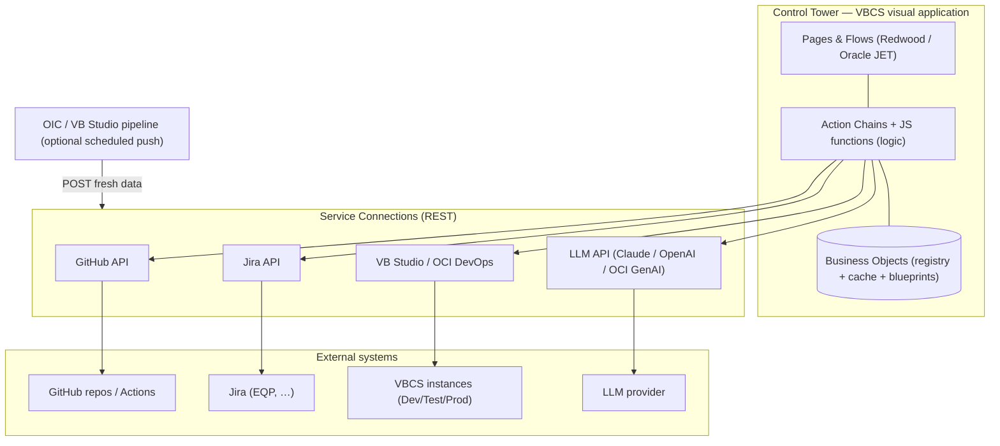
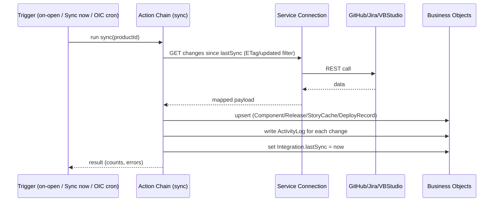
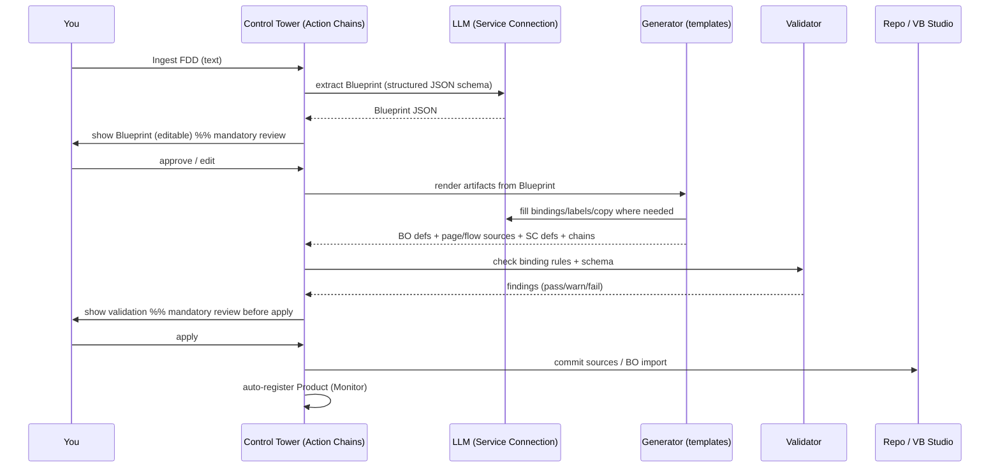

# Control Tower — Technical Design Document (TDD)

**How it's built in VBCS: architecture, data model, integrations, the readiness algorithm, and the AI FDD‑Interpreter pipeline.**
Companion to the RD (what/why) and FDD (functional how). This is the *technical how*.

| | |
|---|---|
| **Product** | Control Tower — development‑lifecycle cockpit + AI builder (VBCS) |
| **Document** | TDD v0.1 (draft for review) |
| **Reads with** | `control-tower-RD.md`, `control-tower-FDD.md` |
| **Date** | 2026‑11‑07 |

> Control Tower has **two subsystems**: the **Monitor** (watches every product's lifecycle) and the **Builder** (the AI FDD Interpreter that scaffolds VBCS apps from an FDD). Both are ordinary VBCS constructs — Business Objects, Service Connections, Action Chains, Pages — plus one external dependency: an LLM reached over REST.

---

## 1. Architecture overview



- **Monitor:** Service Connections pull lifecycle data on a cadence → Action Chains map it → upsert into Business Objects (cache) → Pages render from the cache (fast, rate‑limit friendly). Readiness is computed from gate results.
- **Builder:** an Action Chain sends the FDD to the LLM → receives a structured Blueprint → stores it in Business Objects → on approval, a generator turns the Blueprint into VBCS artifacts (BO import files + page/flow sources + service‑connection defs + action chains) → a validator checks them → they're committed to a repo / VB Studio project, or exported.

---

## 2. VBCS building‑block mapping

| Capability | VBCS construct |
|---|---|
| Registry + cached external data + blueprints | **Business Objects** |
| Call GitHub / Jira / VB Studio / LLM | **Service Connections** (REST) |
| Business logic (sync, scoring, generation orchestration) | **Action Chains** + **JavaScript functions** (app / flow / page scope) |
| UI | **Pages & Flows** on Redwood templates + Oracle JET (`oj-*`) components; reuse the EquipRite shell + binding conventions |
| Scheduled work (VBCS has no strong native scheduler) | **OIC** integration / **VB Studio pipeline** / Fusion **ESS** hitting a Control Tower REST endpoint; MVP = on‑open + manual "Sync now" |
| Secrets / auth | **Service Connection authentication** (never stored in a Business Object) |

---

## 3. Data model (Business Objects)

### 3.1 Monitor objects

| Object | Key fields (type) | Relationships |
|---|---|---|
| **Product** | name (str), description (str), owner (str), phase (enum), status (enum), repoUrl (str), jiraProject (str), vbStudioUrl (str) | → Components, Releases, Environments, Risks, Dependencies |
| **Component** | name (str), type (enum: web/mobile/desktop/api/integration), versionScheme (enum), currentVersion (str) | ↳ Product |
| **Release** | version (str), suiteVersion (str), targetDate (date), train (str), state (enum), readinessPct (int), notes (clob) | ↳ Product; → GateResults, DeployRecords |
| **Gate** *(template)* | name (str), type (enum: auto/manual), rule (str), weight (int), blocking (bool) | used by GateResult |
| **GateResult** | status (enum: pass/warn/fail/na), source (str), detail (str), checkedAt (ts) | ↳ Release, ↳ Gate |
| **Environment** | name (enum: Dev/Test/Prod), url (str), deployedVersion (str), deployedAt (ts), health (enum) | ↳ Product |
| **DeployRecord** | version (str), env (str), deployedAt (ts), result (enum), durationSec (int) | ↳ Product (for DORA) |
| **Idea** | title (str), problem (str), value (enum), effort (enum), score (num), status (enum) | may link → Product/Release |
| **StoryCache** | jiraKey (str), summary (str), status (str), hasAcceptanceCriteria (bool), sprint (str), fixVersion (str) | ↳ Product |
| **Risk** | title (str), severity (enum), status (enum), owner (str), description (clob) | ↳ Product |
| **Incident** | title (str), severity (enum), status (enum), timeline (clob), postmortem (clob), startedAt/resolvedAt (ts) | ↳ Product (for MTTR) |
| **ADR** | title (str), context (clob), decision (clob), consequences (clob), date (date) | ↳ Product |
| **ProductDoc** | type (enum: RD/FDD/TDD/spec/runbook/other), name (str), url (str), body (clob/attachment), version (str), updatedAt (ts) | ↳ Product — **stores/links the RD, FDD, TDD and design docs** |
| **Dependency** | fromId (ref), toId (ref), kind (enum: depends/calls/shares) | Product/Component graph |
| **Integration** | type (enum), status (enum), lastSync (ts), scope (str) | global |
| **ActivityLog** | ts (ts), actor (str), entityType (str), entityId (ref), action (str), before (clob), after (clob) | append‑only |
| **MetricSnapshot** | productId (ref), metric (enum: deployFreq/leadTime/cfr/mttr/velocity/cycleTime), value (num), window (str), computedAt (ts) | ↳ Product |

### 3.2 Builder (FDD‑Interpreter) objects

| Object | Key fields | Relationships |
|---|---|---|
| **Blueprint** | name (str), sourceFddRef (ref/clob), status (enum: extracting/ready/generating/validated/applied/error), llm (str), createdAt (ts) | → Entities, Pages, Flows, Integrations; ↳ Product |
| **BlueprintEntity** | name (str), description (str) | → BlueprintFields; ↳ Blueprint |
| **BlueprintField** | name (str), dataType (enum), required (bool), relationship (str) | ↳ BlueprintEntity |
| **BlueprintPage** | name (str), pageType (enum: list/detail/form/dashboard), boundEntity (str), components (json), layout (str) | ↳ Blueprint |
| **BlueprintFlow** | fromPage (str), toPage (str), trigger (str), actionChain (str) | ↳ Blueprint |
| **BlueprintIntegration** | name (str), baseUrl (str), endpoints (json), authType (enum) | ↳ Blueprint |
| **GenerationRun** | blueprintId (ref), startedAt (ts), status (enum), target (enum: git/archive/spec), summary (json) | → GeneratedArtifacts, ValidationFindings |
| **GeneratedArtifact** | path (str), kind (enum: bo/page/flow/service/chain/appflow), bytes (clob/attachment) | ↳ GenerationRun |
| **ValidationFinding** | artifactPath (str), rule (str), severity (enum: pass/warn/fail), message (str) | ↳ GenerationRun |

Files too large for a clob (page bundles, archives) use VBCS **file/attachment** fields or are written straight to the git target rather than stored in a BO.

---

## 4. Integrations (Service Connections)

| Connection | Key endpoints used | Auth | Maps to | Notes |
|---|---|---|---|---|
| **GitHub** | `/repos/{o}/{r}`, `/pulls`, `/actions/runs`, `/tags`, `/releases`, `/commits` | fine‑grained PAT (header, via SC auth) | Component versions, GateResult (tests green), Release tags, ActivityLog | paginate; conditional requests (ETag) to save rate limit |
| **Jira** | `/rest/api/3/search` (JQL), `/issue/{k}`, sprint, `/project/{k}/versions` | email + API token (basic, via SC auth) | StoryCache, acceptance‑criteria gate, blockers, fixVersion → Release | read‑only scope |
| **VB Studio / OCI DevOps** | builds, deployments, pipelines | token (via SC auth) | DeployRecord, Environment.deployedVersion, build gate | optional in MVP |
| **LLM** (Builder + AI assist) | provider chat/completions (Claude / OpenAI / OCI GenAI / OpenAI‑compatible) | API key (via SC auth) | Blueprint extraction, artifact generation, release‑note drafts, summaries | reuse the EquipRite "Ask AI with LLM choice" design; user‑selectable |

**Rule:** every token is entered through the Service‑Connection auth flow and is never written to a Business Object, never shown in the UI, never sent to the LLM.

---

## 5. Sync architecture



- **Modes:** (1) on‑open + **"Sync now"** — MVP; (2) cached + periodic; (3) **push** from OIC/VB Studio for near‑real‑time.
- **Incremental:** request only what changed since `lastSync` (updated‑after filters, ETags) to respect rate limits.
- **Idempotent upserts** keyed on natural ids (repo+sha, jiraKey, version).
- **Failure:** keep the last good cache; mark `Integration.status = error`; surface "data may be stale" (FDD §9) and a notification.

---

## 6. Readiness algorithm

```
readiness% = round( Σ(weight_i · score_i) / Σ(weight_i) · 100 )
  where score: pass=1.0, warn=0.5 (configurable), fail=0.0, na→excluded from both sums
If any gate with blocking=true has status=fail:
  state = "Blocked"; readiness = min(readiness, 59)   // can never show green while blocked
Else state = readiness>=80 ? "Ready" : "Warnings"
```
Worked example (the 6 default gates, equal weight, one warn): 5×1.0 + 1×0.5 = 5.5 / 6 = 0.9167 → **92%**… with acceptance‑criteria weighted higher (weight 2), score = (1+1+1+1+1 + 0.5·? ) → tune weights so the demo reads **88%**. Weights live in the **Gate** template and are editable in Admin (changes apply to future scores; each Release stores its score as a snapshot).

---

## 7. The AI FDD‑Interpreter pipeline (Builder)

### 7.1 Stages


### 7.2 The key design decision: **templates, not raw LLM, for structure**
The LLM is excellent at *interpretation* (what entities/pages/flows an FDD implies) and poor at emitting large, rigidly‑valid VBCS metadata. So:
- **LLM output = the Blueprint** (a compact, well‑specified JSON) + small content fragments (labels, binding expressions, copy).
- **Deterministic templates** turn the Blueprint into the actual VBCS files (page JSON, HTML, `app-flow.json`, BO import, service catalogs, AMD action‑chain classes).
This keeps generated apps **structurally valid** and dramatically reduces hallucinated metadata.

### 7.3 Blueprint JSON (shape)
```json
{
  "product": "FleetTrack",
  "entities": [
    {"name":"Vehicle","fields":[
      {"name":"plate","type":"string","required":true},
      {"name":"status","type":"enum","values":["Active","Service"]},
      {"name":"depot","type":"reference","to":"Depot"}]}
  ],
  "pages": [
    {"name":"Vehicles","type":"list","entity":"Vehicle","columns":["plate","status","depot"]},
    {"name":"Vehicle detail","type":"detail","entity":"Vehicle"}
  ],
  "flows": [{"from":"Vehicles","to":"Vehicle detail","trigger":"rowClick"}],
  "integrations": [{"name":"Telematics","baseUrl":"…","auth":"bearer","endpoints":["/positions"]}],
  "roles": ["Dispatcher","Driver"]
}
```

### 7.4 Generation targets
- **Business Objects** → VBCS BO import file(s) from `entities` (fields, types, relationships).
- **Pages & features** → page JSON + HTML + JS from `pages` (list/detail/form/dashboard templates, bound to BOs, Redwood look).
- **Flows** → `app-flow.json` nav + action chains from `flows`.
- **Service Connections** → REST catalog defs from `integrations` (auth left as a secure‑flow placeholder — never a real key).
- **Action chains** → AMD classes named after their file (project convention).

### 7.5 Validator (gate before apply)
Checks generated pages against the rules we learned building EquipRite:
- no arrow functions / `String()` / `Number()` / `Boolean()` in bindings;
- `:style` must be an object, not a string;
- no `oj-bind-for-each` inside select/table;
- action chains are AMD classes named like their file;
- every BO reference resolves; required fields present; no duplicate ids.
Findings are pass/warn/fail; **fail blocks Apply**.

### 7.6 Apply modes
- **A — Scaffold‑to‑git (recommended):** commit the generated source tree + BO import to the product's repo / VB Studio project; VB Studio imports/builds → a running VBCS app.
- **B — Export archive:** produce a downloadable VBCS Visual Application import + BO import files to import by hand.
- **C — Spec only:** just the Blueprint + artifacts for a developer to apply.

### 7.7 Honest limits & roadmap
- Output is a **first‑cut scaffold** (data model + pages + nav + connections). Complex business logic, pixel‑perfect layout, and intricate integrations still need human finishing in Designer.
- **Iterative regen (roadmap):** re‑feed an updated FDD → generate → **diff** against the existing app and merge, instead of overwriting.
- Everything passes **two human gates** (Blueprint, pre‑Apply); nothing auto‑deploys to prod.

---

## 8. Security

- **Tokens** (GitHub/Jira/VB Studio/LLM) live only in Service‑Connection auth; least‑privilege scopes (GitHub fine‑grained, Jira read‑only).
- **No secrets to the LLM**, and secrets never in Business Objects or ActivityLog.
- **LLM data handling:** FDDs may contain IP. Offer **OCI GenAI** (stays in your Oracle tenancy) for sensitive FDDs, and Claude/OpenAI for best quality — user choice per run (reuse the EquipRite LLM‑picker pattern).
- **Generated code is reviewed** (validation + human) before apply; **never auto‑deployed to prod**.
- **Audit:** every change and every applied artifact is logged (ActivityLog).

---

## 9. Performance & rate limits
- Render pages from the BO **cache**, not live API calls per render.
- **Incremental sync** (updated‑after / ETag); paginate; exponential backoff on 429/5xx.
- Batch LLM calls; cap FDD size per run; show "last synced" and generation progress.

## 10. Error handling & resilience
- Sync error → keep cache, mark stale, notify (never silently show stale as current).
- Generation error → **stage‑level error with the real detail** (same philosophy as the EquipRite transcribe fix: show the actual cause, not a generic message); partial runs are resumable.
- LLM returns invalid JSON → reject, show raw response, offer retry (don't half‑apply).

## 11. Deployment, versioning, CI (dogfood)
- Standard VBCS **dev → stage → publish**; sources in git; **`main` + tags** from commit #1; `CHANGELOG.md` + `VERSIONS.md`.
- **CI** (GitHub Actions) runs lint + the validator + tests on every PR.
- Control Tower is **Product #1 in its own registry** — it monitors (and eventually re‑scaffolds) itself.

## 12. Open technical decisions (need your call)
1. **Builder apply target & autonomy** — recommend **A (scaffold‑to‑git) + mandatory human review**; alternatives B/C or more autonomy.
2. **Default LLM** — recommend **OCI GenAI for sensitive FDDs**, Claude for quality, user‑selectable per run.
3. **Sync mode for MVP** — recommend **on‑open + "Sync now"**, add OIC/pipeline push later.
4. **Single‑user vs multi‑user** data model now — recommend modelling roles now, enforce later.
5. **Build order** — recommend **Monitor MVP first** (fast value), then the **Builder** as the flagship v2 track (it's the harder, higher‑risk piece).

---

*Together the RD + FDD + TDD fully specify Control Tower. Next step on your word: lock §12, create the repo, and scaffold the VBCS skeleton (shell + Portfolio) from commit #1.*
