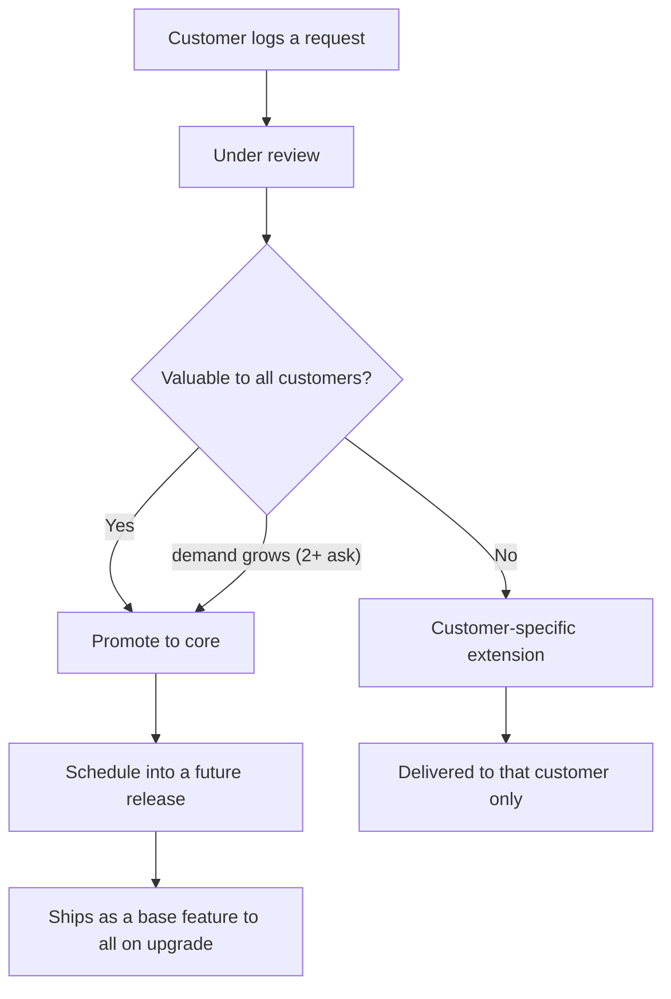
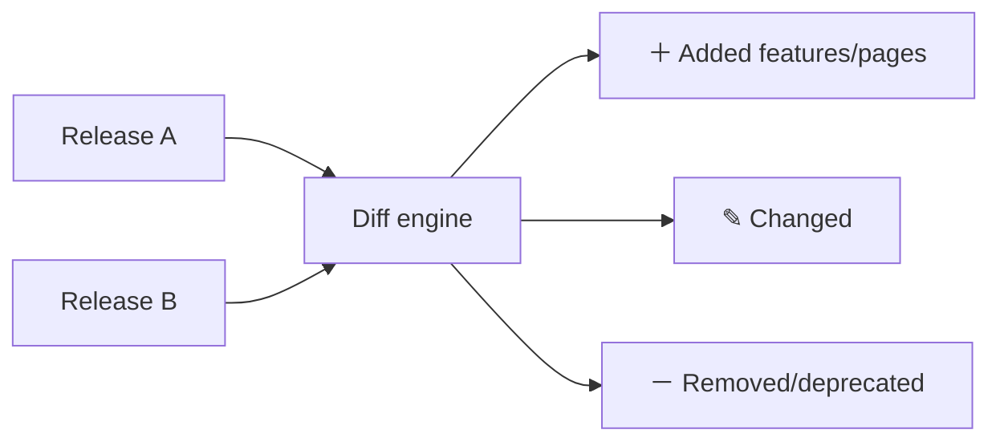
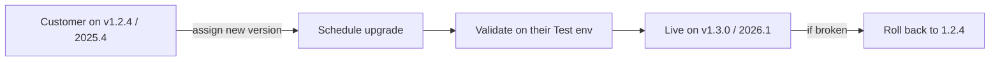

# Control Tower — Design Addendum 1: Customers, Deployments & Feature Governance

**Extends the RD / FDD / TDD with multi-customer deployment tracking and customer-specific feature management.**

| | |
|---|---|
| **Adds to** | RD (scope), FDD (screens S17–S21), TDD (data model) |
| **Status** | Draft v0.1 |
| **Date** | 2026‑11‑08 |

> **The shift:** Control Tower now tracks not just *a product's* lifecycle, but *every customer's deployment of it* — which version/release each customer runs, what features they have (base + their own), what they're asking for, and whether those asks become core product or stay customer-specific. This is the **Oracle Fusion model** (Part 6) at your scale: **one core codebase + per-customer extensions, with common asks promoted to the core.**

---

## 1. Concepts

| Concept | Definition |
|---|---|
| **Release** | a versioned build of the product; **contains a set of features and pages** |
| **Feature** | a unit of capability. Type = **core** (in the base codebase, all customers) / **customer-specific** (one customer's extension) / **candidate** (customer-requested, being promoted to core) |
| **Deployment** | a customer running a specific **version/release** on an environment (Dev/Test/Prod), with date + history |
| **Customer** | an organisation the product is deployed to; has a deployment, a feature set, and requests |
| **Customer feature set** | **base features** (from their version) **＋ customer-specific** features they asked for |
| **Enhancement request** | a customer ask (new feature / modification / enhancement / bug) with a **status** and a **disposition** |
| **Disposition** | the governance decision per request: **Promote to core** · **Customer-specific** · **Under decision** |

---

## 2. The governance idea (the important part)

When a customer asks for something, Control Tower forces one decision:

```
Customer request ──► is this valuable to ALL customers?
                      ├─ Yes ─► PROMOTE TO CORE ──► becomes a base feature in a future release
                      │                              (every customer gets it on upgrade)
                      └─ No  ─► CUSTOMER-SPECIFIC ─► a per-customer extension, not in the core codebase
```

**Demand analysis drives the decision.** The **feature × customer matrix** shows how many customers have or want each feature:
- A feature wanted by **≥ 2 customers** auto-surfaces as a **promote candidate**.
- A feature wanted by **one** stays customer-specific — unless demand grows.

This is exactly how Oracle decides what goes into the quarterly Fusion release vs stays a customer extension — just sized for you.

---

## 3. New Business Objects (extends TDD §3)

| Object | Key fields | Relationships |
|---|---|---|
| **Feature** | name, module, type (core/customer/candidate), status, introducedInRelease (ref), originCustomer (ref, nullable), demandCount (int) | ↳ Product; ↔ Releases, ↔ Customers |
| **ReleaseFeature** | releaseId (ref), featureId (ref), changeType (enum: added/changed/removed) | enables **release diff** |
| **PageInRelease** | releaseId (ref), pageName, changeType | tracks pages per release |
| **Customer** | name, type (internal/external), industry, status, primaryContact, since (date) | → Deployments, CustomerFeatures, FeatureRequests |
| **Deployment** | customerId (ref), productId (ref), version, releaseId (ref), environment (enum), deployedAt (ts), status (live/scheduled/upgrading) | ↳ Customer — **"what version/release is live for whom"** |
| **CustomerFeature** | customerId (ref), featureId (ref), source (enum: base/custom), enabled (bool), status | the per-customer feature set |
| **FeatureRequest** | customerId (ref), title, type (new/modification/enhancement/bug), status (enum), disposition (enum: promote-to-core/customer-specific/under-decision), priority, targetRelease (ref), linkedFeature (ref), requestedAt (ts) | ↳ Customer; may → Feature |

---

## 4. New screens (extends FDD §4)

| # | Screen | Job |
|---|--------|-----|
| **S17** | **Customers** | list every customer: deployed version/release, env, base/custom feature counts, open requests. Register a customer. |
| **S18** | **Customer 360** | one customer: **Deployment** (version/release/env + history + upgrade), **Features** (base + customer-specific), **Enhancement requests** (status + disposition) |
| **S19** | **Features & demand** | feature catalog + the **feature × customer matrix** (common vs specific) + demand bars + promote candidates |
| **S20** | **Enhancements** | all customer requests across customers, with status + disposition (promote-to-core vs customer-specific) |
| **S21** | **Compare releases** | diff two releases: features/pages **added / changed / removed** |

*(All five are now in the clickable prototype.)*

---

## 5. Status & lifecycle models (extends FDD §6)

**Enhancement request status:**
`Requested → Under review → Approved → In build → Delivered` (or `Rejected`).

**Disposition:** `Under decision → (Promote to core | Customer-specific)`.
- *Promote to core* → the request links to a **Feature** (type becomes `candidate`, then `core` once shipped in a release) and gets a **target release**.
- *Customer-specific* → the request produces a **CustomerFeature** (source = custom) for that customer only.

**Deployment status:** `Scheduled → Upgrading → Live` (with rollback to previous version as the exception).

---

## 6. Key flows (extends FDD §7)

**6.1 Enhancement request → core-or-custom**


**6.2 Compare releases**


**6.3 Customer upgrade**


---

## 7. What this unlocks

- **Per-customer truth:** at any moment, know exactly what version/release each customer runs and what features they have.
- **No lost customizations:** every customer-specific feature is tracked against its customer and its originating request.
- **Roadmap from real demand:** the matrix shows what customers actually ask for; common asks become core, so you build the right things once instead of many times.
- **Clean upgrades:** because core and customer-specific are separated (the Oracle model), upgrading a customer to a new release doesn't lose their extensions.

---

*Next: fold these objects/screens into the main FDD/TDD on build, and decide — when we start — whether multi-customer tracking is in the Monitor MVP or a fast-follow.*
